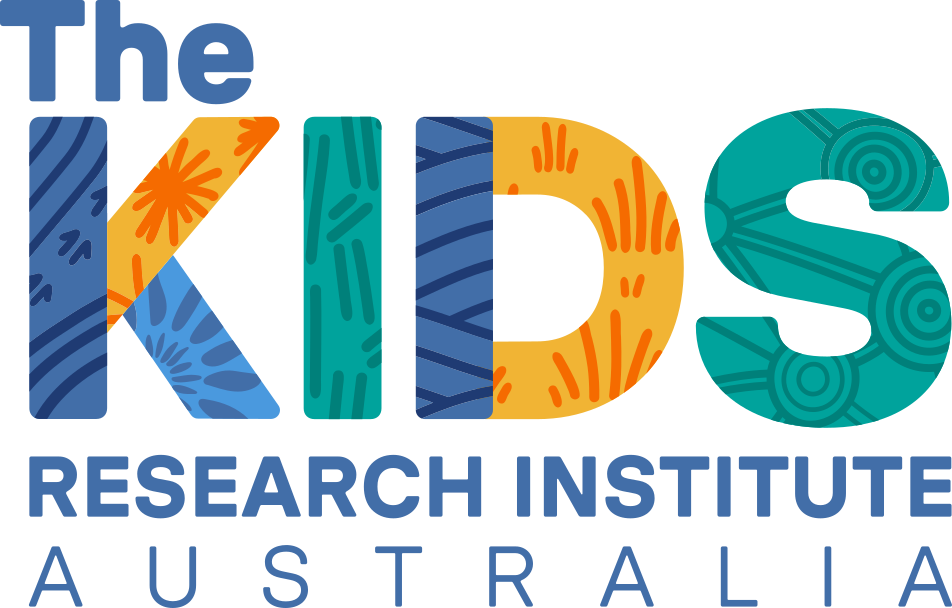

# Indigenous vs. non-Indigenous child health outcomes

Identify and quantify disparity in health indices between Indigenous and non-Indigenous children from conception to 5 years of age

 
<a href="https://futurechildhealth.org/sofia-garreffa/">Sofia Garreffa</a>  
University of Western Australia, Perth, Australia  
<a href=mailto:23824941@student.uwa.edu.au>e-mail</a>  
 
Dr <a href="https://futurechildhealth.org/team/dr-melinda-a-judge/">Melinda A. Judge</a>  
The Kids Research Institute Australia & University of Western Australia, Perth, Australia  
<a href=mailto:melinda.judge@thekids.org.au>e-mail</a>  
 
Prof <a href="https://globalecologyflinders.com/people/#DIRECTOR">Corey J. A. Bradshaw</a>  
<a href="http://globalecologyflinders.com" target="_blank">Global Ecology</a> | <em><a href="https://globalecologyflinders.com/partuyarta-ngadluku-wardli-kuu/" target="_blank">Partuyarta Ngadluku Wardli Kuu</a></em>, <a href="http://flinders.edu.au" target="_blank">Flinders University</a>, Adelaide, Australia  
October 2026  
<a href=mailto:corey.bradshaw@flinders.edu.au>e-mail</a>  
 

## <a href="https://github.com/cjabradshaw/IndigNonIndigHealthCompare/tree/main/scripts">Scripts</a>
- <code>I_NI_outcomeOR.R</code> (main code)

## <a href="https://github.com/cjabradshaw/IndigNonIndigHealthCompare/tree/main/data">Data</a>
- <em>I_NI_outcomeOR3.csv</em>: systematic review dataset

## R libraries
<code>countrycode</code>, <code>dplyr</code>, <code>ggplot2</code>, <code>ggpubr</code>
 
 

 &nbsp;  &nbsp; &nbsp;  &nbsp; &nbsp;  &nbsp; &nbsp; 

